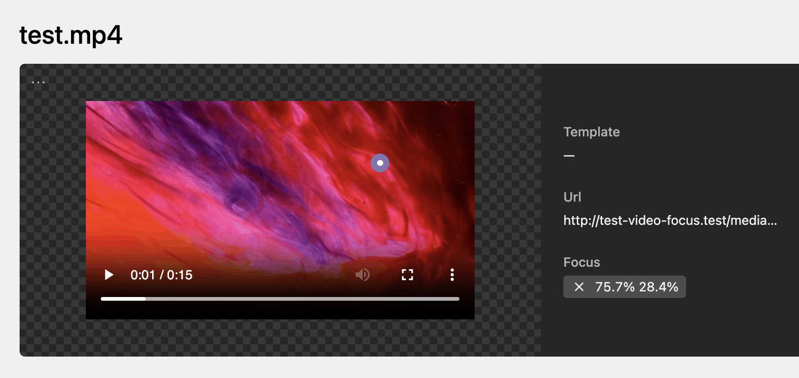

# Kirby Video Focus

Adds a focus point picker to video files in the [Kirby](https://getkirby.com/) Panel, writing the same `focus` field that images already use.



## Requirements

- Kirby 5+
- PHP 8.2+

## Installation

```bash
composer require medienbaecker/kirby-video-focus
```

> [!TIP]
> If you don't use Composer, you can download this repository and copy it to `site/plugins/kirby-video-focus`.

## License

MIT
